# Divvy Bike-Share — Data Understanding & Preprocessing

**DES431 Big Data Analytics and Machine Learning — Course Project**
Workstream 1 of 6: *Data Understanding* and *Data Preprocessing*

| | |
|---|---|
| **Dataset** | Divvy (Chicago) public bike-share trip records |
| **Period** | October 2024 – September 2025 (12 monthly files) |
| **Raw volume** | 5,539,521 trips · 13 columns · 1,119 MB CSV |
| **Curated output** | 5,397,171 trips · 33 columns · 362 MB Snappy Parquet |
| **Rows removed** | 142,350 (2.57%) — every one attributable to a named rule |
| **Validation** | 13/13 automated checks pass |

---

## 1. What this workstream delivers

This document covers the first two stages of the group pipeline. It hands the
downstream stages a partitioned, validated, feature-rich Parquet dataset plus the
contracts needed to consume it.

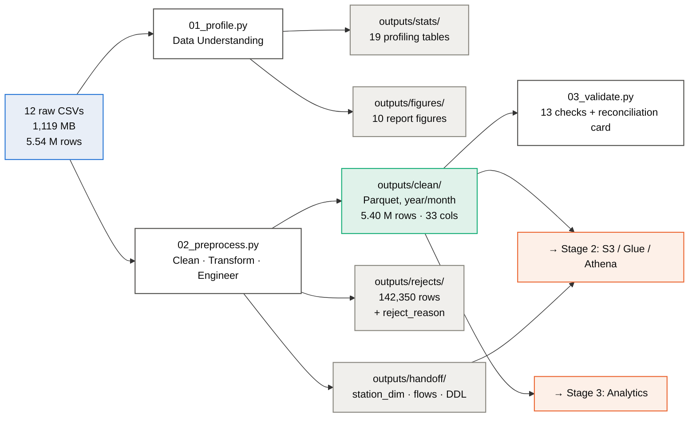

**Scope boundary.** This workstream produces *analysis-ready data*, not analysis.
Demand modelling, temporal/spatial analytics and station-imbalance work belong to
Stage 3; the aggregates in `outputs/handoff/` exist to make that work possible, and
the descriptive statistics in §7 are included only to demonstrate that the curated
dataset behaves sensibly.

---

## 2. How to run it

```bash
pip install pandas numpy pyarrow matplotlib

python scripts/01_profile.py          # ~3 min  → stats + figures F1–F7
python scripts/02_preprocess.py       # ~6 min  → clean Parquet + rejects + handoff
python scripts/03_validate.py         # ~2 min  → 13 checks + figures F8–F10
python scripts/04_data_dictionary.py  # instant → data dictionaries + Athena DDL
```

Every script streams **one month at a time** and never holds the full 5.5 M rows in
memory, so the whole pipeline runs on a laptop with 8 GB of RAM.

### Repository layout

```
Project/
├── archive/CSV_Files/          12 raw monthly CSVs (input, never modified)
├── scripts/
│   ├── common.py               shared config, thresholds, geohash + haversine
│   ├── 01_profile.py           TASK 1 — profiling, no mutation
│   ├── 02_preprocess.py        TASK 2 — cleaning, transformation, features
│   ├── 03_validate.py          TASK 2 — assertions + reconciliation card
│   ├── 04_data_dictionary.py   schema documentation + Athena DDL
│   └── spark_preprocess.py     PySpark port of 02 for AWS Glue
└── outputs/
    ├── stats/                  19 CSV/JSON profiling tables
    ├── figures/                10 PNG figures for the deck and report
    ├── clean/year=/month=/     curated Parquet fact table
    ├── rejects/                every dropped row + why
    └── handoff/                station_dim · station_hourly_flow · athena DDL
```

---

# PART 1 — DATA UNDERSTANDING

## 3. Dataset overview

Divvy publishes one CSV per month of anonymised trip records. The grain is **one row
per trip**, which makes this a natural fact table. All 12 files share an identical
13-column schema — there is no schema drift to reconcile.

| Property | Value |
|---|---|
| Files | 12 monthly CSVs |
| Rows | **5,539,521** |
| Columns | 13 |
| Raw size | 1,119 MB |
| Grain | one trip |
| Timestamp range | 2024-09-30 19:20:33 → 2025-09-30 23:59:57 |
| Structure | Structured, tabular, comma-delimited, quoted, UTF-8 |
| Duplicate `ride_id` | **0** within-file, **0** across files |
| Distinct station names | 1,920 |
| Split | 63.97% member / 36.03% casual · 62.50% e-bike / 37.50% classic |

### 3.1 Raw data dictionary

| # | Column | Type | % missing | Description |
|---|---|---|---|---|
| 1 | `ride_id` | string | 0.00 | Unique trip identifier (16-char hex). Natural primary key |
| 2 | `rideable_type` | string | 0.00 | `classic_bike` \| `electric_bike` |
| 3 | `started_at` | timestamp | 0.00 | Trip start, local Chicago time, millisecond precision |
| 4 | `ended_at` | timestamp | 0.00 | Trip end |
| 5 | `start_station_name` | string | **20.38** | Docking station at origin — NULL for dockless trips |
| 6 | `start_station_id` | string | **20.38** | Divvy station code — **unreliable, see §5.2** |
| 7 | `end_station_name` | string | **21.23** | Docking station at destination |
| 8 | `end_station_id` | string | **21.23** | Divvy station code — **unreliable** |
| 9 | `start_lat` | double | 0.00 | Origin latitude, WGS84 |
| 10 | `start_lng` | double | 0.00 | Origin longitude, WGS84 |
| 11 | `end_lat` | double | 0.10 | Destination latitude |
| 12 | `end_lng` | double | 0.10 | Destination longitude |
| 13 | `member_casual` | string | 0.00 | `member` (subscriber) \| `casual` (pay-per-ride) |

*Generated: `outputs/stats/15_data_dictionary_raw.csv`*

## 4. Volume and seasonality

Monthly volume swings by a factor of **5.7×** between the January trough (138,689)
and the August peak (790,177). Any model or dashboard built on this data must treat
seasonality as a first-order effect, not noise.

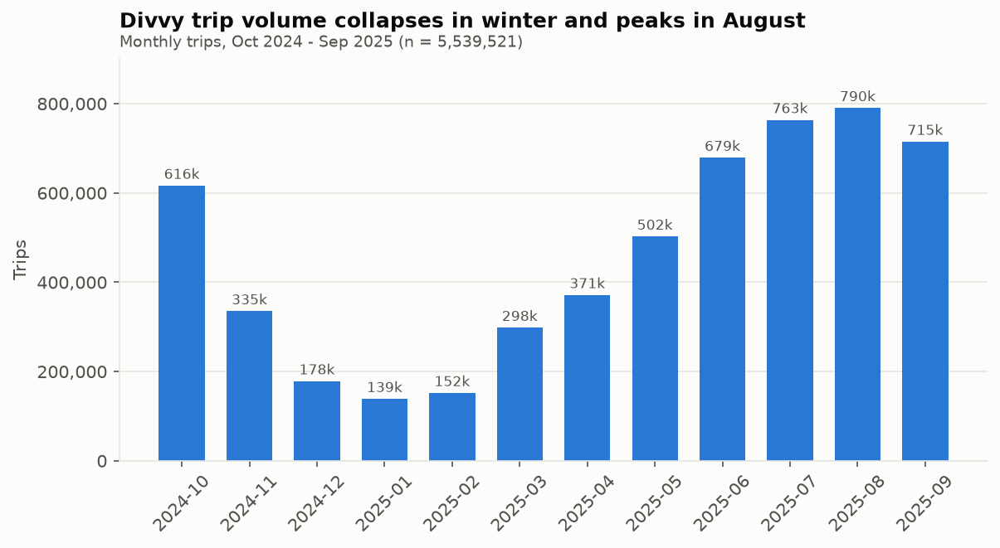

| Month | Trips | Member | Casual | Median duration |
|---|---:|---:|---:|---:|
| 2024-10 | 616,281 | 399,835 | 216,446 | 9.23 min |
| 2024-11 | 335,075 | 241,997 | 93,078 | 8.00 min |
| 2024-12 | 178,372 | 139,996 | 38,376 | 7.43 min |
| 2025-01 | **138,689** | 114,536 | 24,153 | **6.80 min** |
| 2025-02 | 151,880 | 124,126 | 27,754 | 6.96 min |
| 2025-03 | 298,155 | 212,286 | 85,869 | 8.34 min |
| 2025-04 | 371,341 | 262,125 | 109,216 | 8.55 min |
| 2025-05 | 502,456 | 319,819 | 182,637 | 9.53 min |
| 2025-06 | 678,904 | 386,811 | 292,093 | 10.67 min |
| 2025-07 | 763,432 | 440,095 | 323,337 | 10.46 min |
| 2025-08 | **790,177** | 452,439 | 337,738 | **10.68 min** |
| 2025-09 | 714,759 | 449,298 | 265,461 | 9.89 min |

*Generated: `outputs/stats/01_volume_by_month.csv`*

## 5. Data quality assessment

Four issues matter. Three are defects; **one is not a defect at all**, and treating
it as one would be the single most damaging mistake available in this project.

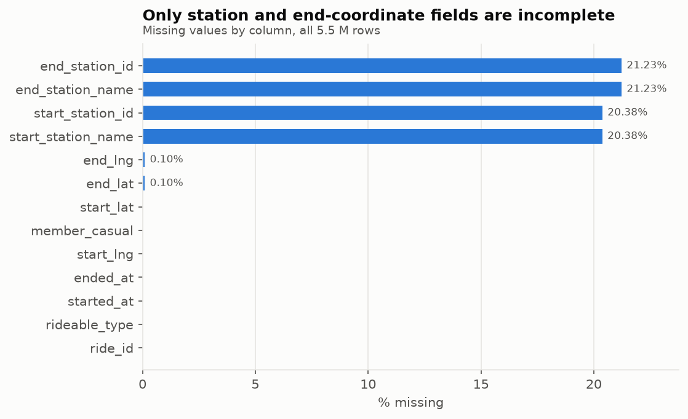

### 5.1 Finding 1 — Missing stations are structural, not random

20.38% of trips have no start-station name. The instinct is to drop or impute them.
Both are wrong. Splitting missingness by bike type explains **100%** of it:

| Bike type | Trips | Missing start station | Rate |
|---|---:|---:|---:|
| `classic_bike` | 2,077,053 | 0 | **0.00%** |
| `electric_bike` | 3,462,468 | 1,129,029 | **32.61%** |

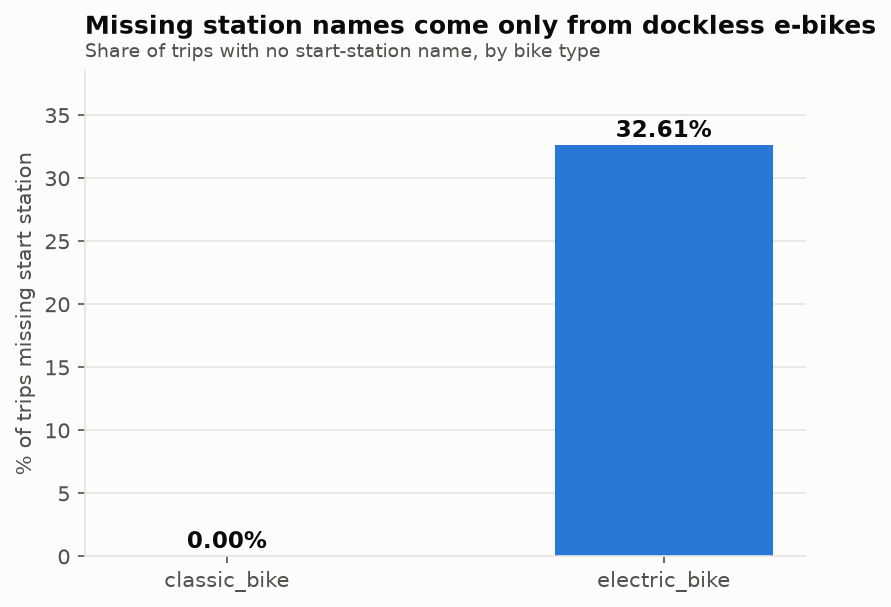

Divvy e-bikes are **dockless**: a rider may lock one to any public rack, so no
station is recorded. Classic bikes must be returned to a dock, so they *never* have
a missing station. The nulls encode a real operational mode.

In missing-data terms this is **MNAR** (Missing Not At Random) — the probability of
absence depends on an observable property of the trip itself. The consequences:

- **Dropping** these rows would delete 32.6% of all e-bike trips and bias every
  downstream demand estimate toward the docked, classic-bike population.
- **Imputing** a station name would fabricate dock activity that never happened,
  corrupting exactly the station-imbalance analysis the group intends to run.
- The **correct** treatment is to keep the rows, encode the condition explicitly
  (`trip_type`), and give them an alternative spatial identity — the coordinates
  are always present, so a geohash cell works where a station name does not (§9.2).

Distribution of the condition across both endpoints:

| Condition | Trips | Share |
|---|---:|---:|
| Both endpoints docked | 3,770,024 | 68.06% |
| Exactly one endpoint dockless | 1,234,130 | 22.28% |
| Both endpoints dockless | 535,367 | 9.66% |

### 5.2 Finding 2 — `station_id` is corrupt and must never be used as a join key

| Check | Result |
|---|---:|
| Distinct cleaned station names | 1,920 |
| Distinct `station_id` values | 3,435 |
| **Names mapping to more than one `station_id`** | **1,589** (82.8% of names) |
| **`station_id`s mapping to more than one name** | **105** |
| Names with leading/trailing/double whitespace | 13 |

Two independent defects are at work:

**Re-numbering.** Divvy migrated from numeric IDs to a `CHIxxxxx` scheme partway
through the study window, and both appear in the data:

```
'California Ave & Milwaukee Ave'  →  13084  |  CHI00307
'Wood St & Chicago Ave'           →  637    |  CHI01183
```

**Recycling.** Retired IDs were reassigned to unrelated stations:

```
637  →  'Wood St & Chicago Ave'        |  'Public Rack - Ewing Ave & 96th St N'
577  →  'Stony Island Ave & S Chicago' |  'Public Rack - Ozark Ave & Addison St'
```

A `GROUP BY station_id` therefore **fragments** most stations into two or more and
**merges** 105 pairs of unrelated ones. The station-imbalance analysis would be
silently wrong, with no error message to warn anyone.

**Resolution:** derive a surrogate key from the normalised station *name*, and demote
`station_id` to a traceability-only column. See §9.1.

*Full listings: `outputs/stats/06b_names_with_multiple_ids.csv`, `06c_ids_with_multiple_names.csv`*

### 5.3 Finding 3 — Duration has junk at both tails

| Statistic | Minutes | | Percentile | Minutes |
|---|---:|---|---|---:|
| mean | 16.06 | | p1 | 0.27 |
| std | 54.62 | | p25 | 5.41 |
| min | **−56.02** | | p50 | **9.45** |
| max | 1,574.90 | | p75 | 16.61 |
| | | | p95 | 40.02 |
| | | | p99 | 89.86 |
| | | | **p99.9** | **1,439.84** |

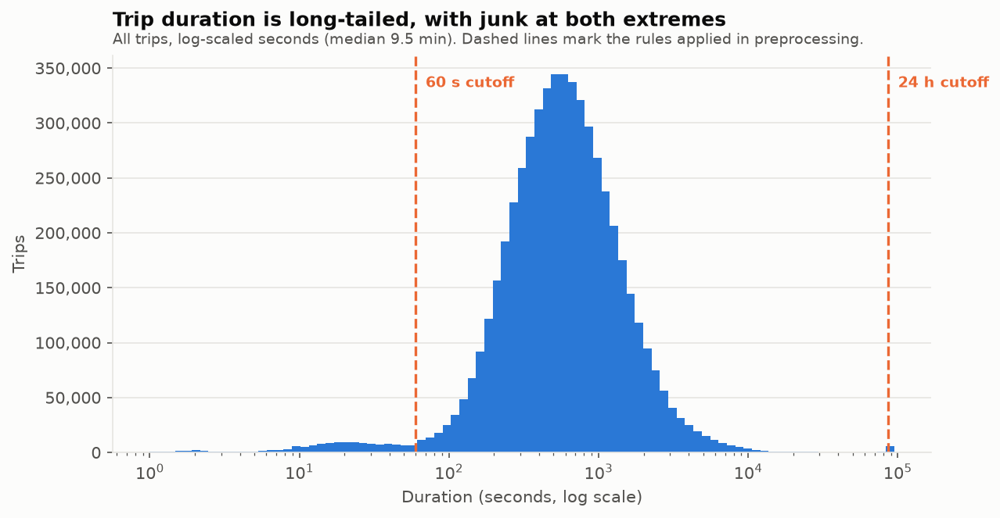

The log-scaled histogram shows **two** populations, not one:

- A **secondary mode around 10–30 seconds** — 136,390 trips under a minute. This is
  the classic failed-checkout signature: a rider undocks a bike, finds a fault, and
  re-docks it immediately. These are not journeys.
- A **spike at exactly 24 hours**. p99.9 lands at 1,439.84 min, fractionally under
  the 1,440-minute mark, and 5,533 trips exceed it. That is a system auto-close on
  bikes that were never properly returned, not a day-long ride.
- **43 trips end before they start** (minimum −56 min), most likely daylight-saving
  or clock-sync artefacts.

### 5.4 Finding 4 — Coordinates contain a handful of GPS failures

The raw coordinate range is alarming: latitude spans **35.50 → 83.14** and longitude
**−94.27 → 152.53**. A longitude of 152° is the western Pacific; a latitude of 83° is
the high Arctic. Divvy operates only in Chicago (roughly 41.6–42.1 °N, −87.9–−87.5 °W).

Bounded against a Chicago service-area box, however, only **24 rows out of 5.54 M**
(0.0004%) fall outside. These are isolated GPS fixes, not a systematic problem —
but they had to be measured to be dismissed, and left in place they would stretch
every map axis and distance statistic in the project.

---

# PART 2 — DATA PREPROCESSING

## 6. Cleaning rules and the quality register

Six rules are applied. Each row that is dropped is tagged with **exactly one**
reason, assigned in rule order, and written to `outputs/rejects/` so that any
number in this report can be traced back to the individual records behind it.

| Rule | Condition | Rationale | Matched | **Removed** |
|---|---|---|---:|---:|
| **R1** | `end_lat` or `end_lng` is NULL | Distance is not computable | 5,442 | **5,442** |
| **R2** | `ended_at < started_at` | Physically impossible | 43 | **43** |
| **R3** | duration < 60 s | Failed checkout / immediate re-dock | 136,390 | **136,390** |
| **R4** | duration > 24 h | System auto-close, not a ride | 5,533 | **208** |
| **R5** | coordinates outside Chicago bbox | GPS error | 24 | **24** |
| **R6** | average speed > 60 km/h | Impossible on a bicycle | 18,046 | **243** |
| | | **TOTAL** | 165,478 | **142,350** |

**Net effect: 5,539,521 → 5,397,171 rows. 142,350 removed (2.57%).**

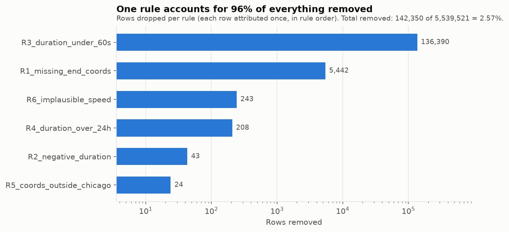

The gap between *matched* and *removed* is itself a finding, because the rules
overlap heavily:

- **R4 matches 5,533 but only owns 208.** The other 5,325 over-24-hour trips were
  already caught by R1 — they have no end coordinates. This is strong evidence for
  the auto-close interpretation in §5.3: a ride that runs past 24 hours is almost
  always a bike that was never returned, so the system closes the trip with no
  destination recorded. Two independent defects turn out to be one phenomenon.
- **R6 matches 18,046 but only owns 243.** Nearly all implausible speeds come from
  the sub-minute trips already removed by R3 — a 20-second record covering 500 m
  computes to 90 km/h. Speed is a useful *cross-check* on the duration rules rather
  than an independent filter.

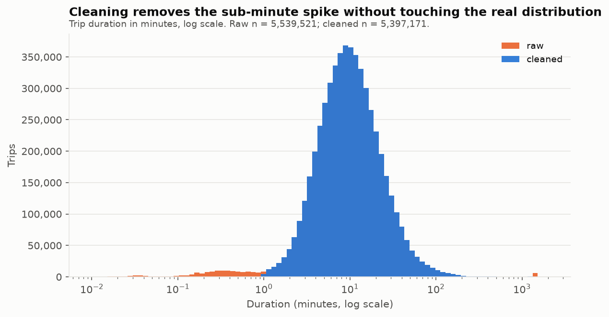

### 6.1 Why the loss rate is 2.57% and not 30%

The naive approach — `df.dropna()` — would have removed **1,769,497 rows (31.9%)**,
because it treats the dockless nulls of §5.1 as damage. Distinguishing structural
missingness from actual defects is worth **1,627,147 trips**, and it is the
difference between an analysis of Chicago bike-share and an analysis of Chicago's
*docked classic bikes only*.

| Approach | Rows kept | Lost | Population studied |
|---|---:|---:|---|
| `dropna()` on all columns | 3,770,024 | 31.9% | Docked trips only — biased |
| **Rule-based (this pipeline)** | **5,397,171** | **2.57%** | Full system |

### 6.2 Structural cleaning also applied

- **De-duplication** on `ride_id`, keeping the first occurrence. Zero duplicates were
  found, but the step stays in the pipeline so the guarantee holds for future months.
- **Whitespace normalisation** on both station-name columns: trim, then collapse
  internal runs of spaces (`'NEW HASTINGS '` → `'NEW HASTINGS'`). 13 names affected.
  Without this, the same station keys twice.

## 7. Descriptive statistics of the curated dataset

Included to demonstrate the cleaned data behaves sensibly, and to give Stage 3 a
starting point. These are observations, not the analysis itself.

**Riders separate cleanly into two behavioural populations.**

| Metric | Member | Casual |
|---|---:|---:|
| Share of trips | 64.47% | 35.53% |
| Mean duration | 12.04 min | **20.15 min** |
| Median duration | 8.71 min | 12.00 min |
| Mean straight-line distance | 2.26 km | 2.23 km |
| Mean speed | 12.49 km/h | 9.82 km/h |
| Round-trip rate (docked trips) | 2.21% | **8.24%** |

Casual riders travel **the same distance** but take **67% longer** and return to
their origin **3.7× more often**. That is a leisure signature against a commuting
one — and it is visible in the temporal profiles too:

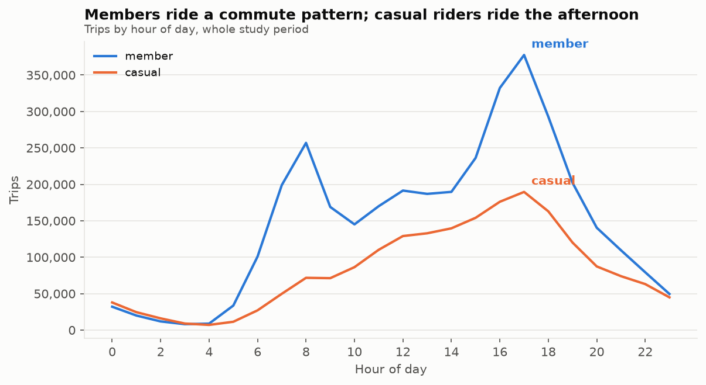

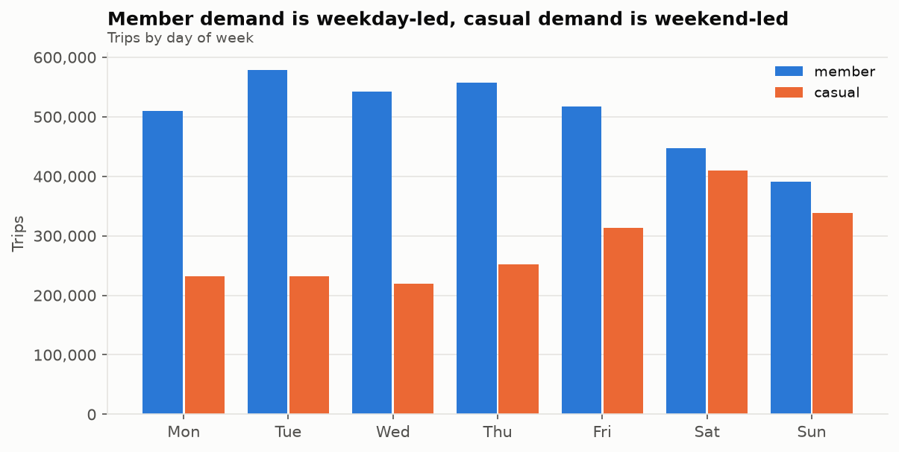

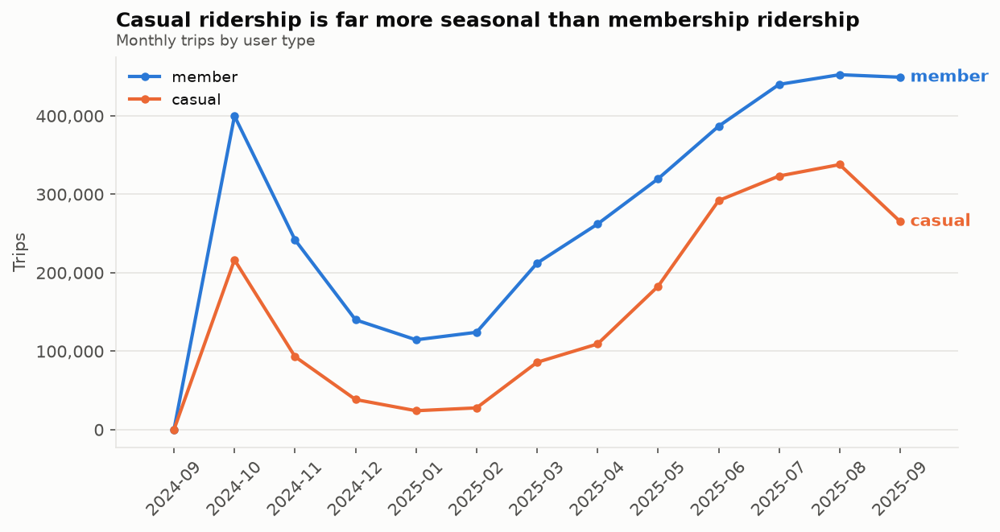

**Seasonality hits the two groups very differently.**

| Season | Trips | Median duration | Casual share |
|---|---:|---:|---:|
| Winter | 459,752 | 7.21 min | **19.09%** |
| Spring | 1,144,098 | 9.09 min | 31.79% |
| Summer | 2,163,589 | 10.91 min | **42.09%** |
| Fall | 1,629,732 | 9.41 min | 34.08% |

Casual ridership more than doubles as a share of the system between winter and
summer, while members ride year-round. Winter demand is close to pure commuting.

**Dockless share is growing.** Trips with at least one dockless endpoint rose from
25.6% (Dec 2024) to 33.4% (Sep 2025) — a structural shift in the fleet that makes
the §5.1 treatment decision more consequential over time, not less.

**Busiest origins** are tourist and lakefront locations (Streeter Dr & Grand Ave,
43,193 trips; DuSable Lake Shore Dr & Monroe St, 39,426) alongside West Loop
commuter stations (Kingsbury St & Kinzie St, 41,423; Clinton St & Washington Blvd,
31,296) — the same two populations, in space.

## 8. Feature engineering

20 columns are engineered onto the 13 source columns, giving a 33-column fact table.

### 8.1 Temporal features

| Feature | Type | Definition |
|---|---|---|
| `duration_min` | float | `(ended_at − started_at)` in minutes, bounded to [1, 1440] |
| `trip_date` | string | `yyyy-MM-dd` of `started_at` |
| `year`, `month` | smallint, tinyint | **Hive partition keys** |
| `day`, `hour` | tinyint | Day of month; hour 0–23 |
| `day_of_week` | tinyint | 0 = Monday … 6 = Sunday (pandas convention) |
| `day_name` | string | `Monday` … `Sunday` |
| `is_weekend` | boolean | `day_of_week >= 5` |
| `season` | string | Meteorological: Winter = Dec–Feb, etc. |
| `time_of_day` | string | Night 0–5, Morning 6–11, Afternoon 12–17, Evening 18–23 |
| `is_rush_hour` | boolean | Weekday **and** hour in 07–09 or 16–18 |

### 8.2 Spatial features

| Feature | Type | Definition |
|---|---|---|
| `start_station_key`, `end_station_key` | string | Name-derived surrogate key (§9.1) |
| `start_geohash7`, `end_geohash7` | string | Geohash precision 7, ≈153 m cell |
| `haversine_km` | float | Great-circle start→end distance |
| `avg_speed_kmh` | float | `haversine_km / (duration_min / 60)` |
| `is_round_trip` | boolean | Start station = end station; **NULL** unless `trip_type = docked` |
| `trip_type` | string | `docked` \| `dockless_start` \| `dockless_end` \| `fully_dockless` |

Three of these deserve justification.

**`haversine_km` is a lower bound, deliberately.** It measures straight-line
distance, whereas the rider follows streets. Because the real path is always longer,
derived speed is always *under*-estimated — so any trip that still computes above
60 km/h is unambiguously bad data. A conservative estimator is the right choice for
an outlier detector.

**`is_round_trip` is NULL, not FALSE, for dockless trips.** A trip with no station
recorded is not a trip that failed to return to its origin; it is a trip whose origin
we cannot name. Encoding "unknown" as "false" would understate round-trip rates on
exactly the population where they are unmeasurable. Validation check 11 asserts this
invariant holds on every row.

**`trip_type` turns the §5.1 finding into a queryable column.** Downstream code can
filter to `trip_type = 'docked'` when a station is genuinely required, and use the
whole population otherwise — a decision made explicitly, in the open, per query,
instead of implicitly by a `dropna()` somewhere.

| `trip_type` | Trips | Share |
|---|---:|---:|
| `docked` | 3,741,013 | 69.31% |
| `dockless_end` | 608,571 | 11.28% |
| `dockless_start` | 589,424 | 10.92% |
| `fully_dockless` | 458,163 | 8.49% |

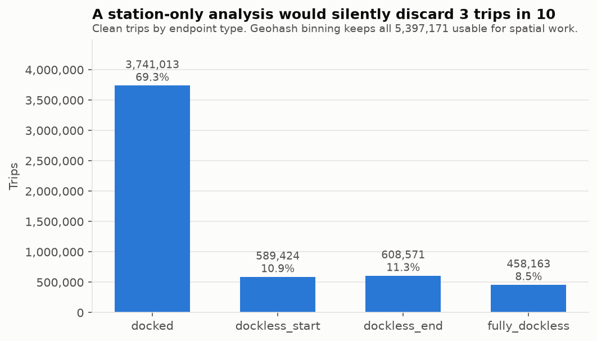

## 9. Two design decisions that protect the downstream analysis

### 9.1 Station identity: key on the name, not the ID

```python
def station_key(name):
    return (name.str.strip()
                .str.replace(r"\s+", " ", regex=True)     # collapse inner whitespace
                .str.upper()                               # case-fold
                .str.replace(r"[^A-Z0-9]+", "_", regex=True)
                .str.strip("_"))

# 'Clark St & Armitage Ave'  →  CLARK_ST_ARMITAGE_AVE
```

This collapses the 3,435 unreliable `station_id` values onto **1,859 stable station
keys**, resolving both the re-numbering and the recycling defects of §5.2 in one
step. `station_id` is retained in the output purely so any row can be traced back to
its source record — the data dictionary marks it **DO NOT JOIN ON THIS**.

The resulting station dimension (`outputs/handoff/station_dim.parquet`, 1,895 rows)
carries the station key, display name, a trip-weighted median coordinate, endpoint
volume, and the list of legacy IDs that were merged into it.

### 9.2 Spatial binning: geohash gives dockless trips a location

Every trip has coordinates even when it has no station. Encoding those coordinates
as a **geohash at precision 7** (≈153 m × 153 m) gives all 5,397,171 trips a spatial
identity, against 3,741,013 for a station-only approach.

```
41.9183, −87.6363  →  dp3wmyc
```

The dataset resolves to **3,291 distinct start cells** versus 1,859 station keys.
Geohashes are hierarchical — truncating the string zooms out — so Stage 3 can
aggregate at 153 m, 1.2 km or 5 km simply by taking a prefix, with no re-processing.
They are plain strings, so they group efficiently in Spark and Athena without a
geospatial extension.

**Without this feature, 30.7% of the cleaned dataset would be invisible to any
spatial analysis.**

## 10. Output schema

`outputs/clean/year=YYYY/month=MM/*.parquet` — Snappy-compressed, Hive-partitioned.

| Column | Athena type | Origin | | Column | Athena type | Origin |
|---|---|---|---|---|---|---|
| `ride_id` | string | source | | `duration_min` | float | engineered |
| `rideable_type` | string | source | | `haversine_km` | float | engineered |
| `member_casual` | string | source | | `avg_speed_kmh` | float | engineered |
| `started_at` | timestamp | source | | `trip_type` | string | engineered |
| `ended_at` | timestamp | source | | `is_round_trip` | boolean | engineered |
| `start_station_name` | string | cleaned | | `trip_date` | string | engineered |
| `start_station_id` | string | source ⚠ | | `year` | smallint | **partition** |
| `start_station_key` | string | engineered | | `month` | tinyint | **partition** |
| `end_station_name` | string | cleaned | | `day` | tinyint | engineered |
| `end_station_id` | string | source ⚠ | | `hour` | tinyint | engineered |
| `end_station_key` | string | engineered | | `day_of_week` | tinyint | engineered |
| `start_lat` | double | validated | | `day_name` | string | engineered |
| `start_lng` | double | validated | | `is_weekend` | boolean | engineered |
| `end_lat` | double | validated | | `season` | string | engineered |
| `end_lng` | double | validated | | `time_of_day` | string | engineered |
| `start_geohash7` | string | engineered | | `is_rush_hour` | boolean | engineered |
| `end_geohash7` | string | engineered | | | | |

⚠ = retained for traceability only; never join on it.

*Generated: `outputs/stats/16_data_dictionary_clean.csv`. Executable DDL:
`outputs/handoff/athena_create_table.sql`.*

### Storage

| | Raw CSV | Curated Parquet |
|---|---:|---:|
| Size | 1,119 MB | **362 MB** |
| Columns | 13 | 33 |
| Rows | 5,539,521 | 5,397,171 |

The curated dataset is **3.1× smaller while carrying 2.5× the columns** — roughly an
8× improvement per column. Columnar encoding plus Snappy does most of that work; the
partitioning means an Athena query filtered to one month reads about 1/12th of the
remainder. This is the concrete argument for Parquet over CSV in the final report.

### Partitioning note

Partitions are derived from `started_at`, not from the source filename. A few trips
begin in one month and appear in the next month's file, so partition counts differ
slightly from file counts — for example `year=2024/month=9` holds **31 rows**, trips
that began on the evening of 2024-09-30. The 14 partitions sum exactly to 5,397,171.

## 11. Validation

`03_validate.py` re-reads the Parquet dataset **from disk** — not from memory — and
asserts the cleaning contract. All 13 checks pass.

| # | Check | Result |
|---|---|---|
| 1 | Duration ≥ 60 s on every row | PASS — min 1.0000 min |
| 2 | Duration ≤ 24 h on every row | PASS — max 1,439.82 min |
| 3 | No negative durations | PASS |
| 4 | No duplicate `ride_id` | PASS — 0 duplicates |
| 5 | No nulls in `ride_id`, `duration_min`, coordinates | PASS |
| 6 | All start coordinates inside Chicago bbox | PASS — lat [41.6400, 42.0700] |
| 7 | All end coordinates inside Chicago bbox | PASS — lat [41.6100, 42.1500] |
| 8 | Average speed ≤ 60 km/h | PASS — max 59.83 km/h |
| 9 | Geohash present on every row | PASS |
| 10 | `trip_type` non-null with exactly 4 levels | PASS |
| 11 | `is_round_trip` NULL exactly when an endpoint is dockless | PASS |
| 12 | `hour` ∈ 0–23, `day_of_week` ∈ 0–6 | PASS |
| 13 | Dockless rows retained | PASS — 1,656,158 kept |

*Generated: `outputs/stats/13_validation_checks.csv`*

## 12. Handoff to the AWS / Big Data stage

The commonest failure mode in a project split this way is that cleaning is written
twice — once in pandas, once in Spark — and the two quietly disagree. Three artefacts
exist to prevent that.

**1. `scripts/spark_preprocess.py`** — a line-for-line PySpark port of the pandas
pipeline, including a pure Spark SQL implementation of the geohash encoder, ready to
run as a Glue job:

```bash
spark-submit scripts/spark_preprocess.py \
    --input   s3://<bucket>/raw/divvy/ \
    --output  s3://<bucket>/curated/divvy_trips/ \
    --rejects s3://<bucket>/rejects/divvy/
```

Two portability details are handled explicitly: Spark's `dayofweek` is 1 = Sunday and
is shifted to match the pandas 0 = Monday convention, and the rule thresholds are
duplicated at the top of the file because a Glue job cannot import `common.py` — if
one changes, **both must change**.

**2. `outputs/handoff/athena_create_table.sql`** — generated from the real Parquet
schema, so the table definition cannot drift from the data:

```sql
CREATE EXTERNAL TABLE IF NOT EXISTS divvy.trips_clean ( ... )
PARTITIONED BY (`year` smallint, `month` tinyint)
STORED AS PARQUET
LOCATION 's3://<your-bucket>/curated/divvy_trips/';

MSCK REPAIR TABLE divvy.trips_clean;   -- required: loads the 14 partitions
```

**3. `outputs/stats/14_reconciliation_card.csv`** — the acceptance test. After the
Glue job runs, `reconcile()` prints these same metrics. **Every value must match.**
If any differs, the two implementations have diverged and the difference must be
found before analysis begins.

| Metric | Expected |
|---|---:|
| `clean_row_count` | 5,397,171 |
| `distinct_ride_id` | 5,397,171 |
| `mean_duration_min` | 14.9240 |
| `median_duration_min` | 9.6848 |
| `mean_haversine_km` | 2.2514 |
| `mean_avg_speed_kmh` | 11.5448 |
| `pct_member` | 64.4710 |
| `pct_electric_bike` | 61.6210 |
| `pct_weekend` | 28.4729 |
| `pct_rush_hour` | 33.7958 |
| `trips_docked` | 3,741,013 |
| `trips_dockless_start` | 589,424 |
| `trips_dockless_end` | 608,571 |
| `trips_fully_dockless` | 458,163 |
| `distinct_start_geohash7` | 3,291 |
| `distinct_start_station_key` | 1,859 |
| `round_trip_share_of_docked` | 4.3709 |

### For the analytics stage

| Artefact | Rows | Contents |
|---|---:|---|
| `handoff/station_dim.parquet` | 1,895 | `station_key`, name, weighted median lat/lng, endpoint volume, merged legacy IDs |
| `handoff/station_hourly_flow.parquet` | 2,353,242 | `station_key` × `trip_date` × `hour` → `departures`, `arrivals`, `net_flow` |

`net_flow = arrivals − departures`; positive means bikes accumulate at that station
in that hour. This is the direct input to the station-imbalance and rebalancing
analysis.

## 13. Limitations

1. **Straight-line distance.** `haversine_km` ignores the street network, so it
   under-states distance ridden — by roughly 20–40% in a gridded city. Fine for
   outlier detection and relative comparison; do not report it as "distance cycled".
2. **Round trips have zero measured distance.** A trip returning to its origin gets
   `haversine_km ≈ 0` and therefore `avg_speed_kmh ≈ 0`. This affects 4.37% of docked
   trips and will drag down any unfiltered mean speed. Exclude `is_round_trip = true`
   when analysing speed.
3. **Rule thresholds are conventions, not physical constants.** 60 s and 24 h follow
   common practice in published Divvy analyses, but they are choices. `outputs/rejects/`
   exists so any of them can be revisited without re-reading the raw CSVs.
4. **Geohash cells are rectangular in degrees**, so cell width varies with latitude.
   Across Chicago's ~0.5° span the distortion is negligible; it would matter for a
   continental study.
5. **No weather data.** Seasonality is described but not explained. Joining NOAA
   daily observations for Chicago would let Stage 3 separate temperature and
   precipitation effects from calendar effects — the most valuable available extension.
6. **Local timestamps.** Divvy publishes local Chicago time with no timezone offset.
   The two DST transitions in the window make one hour ambiguous and one absent;
   this likely explains several of the 43 negative durations. Not material at 5.5 M
   rows, but it should be stated rather than hidden.
7. **One year of data.** Year-over-year trend cannot be separated from seasonality
   with a single cycle.

## 14. Reproducibility

| | |
|---|---|
| Python | 3.14.5 |
| pandas | 3.0.3 |
| numpy | 2.4.6 |
| pyarrow | 25.0.1 |
| matplotlib | 3.11.0 |
| Runtime | ≈11 minutes, single laptop, streaming one month at a time |

All thresholds live in `scripts/common.py`. No step samples, and no step depends on
random state, so the pipeline is deterministic: re-running it reproduces the
reconciliation card exactly.

### References

1. Divvy Bikes, *Divvy System Data*. https://divvybikes.com/system-data (Lyft Bikes and Scooters, LLC — public licence).
2. City of Chicago, *Divvy Bicycle Stations*, Chicago Data Portal.
3. G. Niemeyer, *Geohash*, 2008. http://geohash.org
4. R. W. Sinnott, "Virtues of the Haversine," *Sky and Telescope*, vol. 68, no. 2, p. 159, 1984.
5. R. J. A. Little and D. B. Rubin, *Statistical Analysis with Missing Data*, 3rd ed. Hoboken, NJ: Wiley, 2019. — MNAR framing used in §5.1.
6. Apache Software Foundation, *Apache Parquet Documentation*. https://parquet.apache.org/docs/
7. Amazon Web Services, *AWS Glue Developer Guide* and *Amazon Athena User Guide*.
