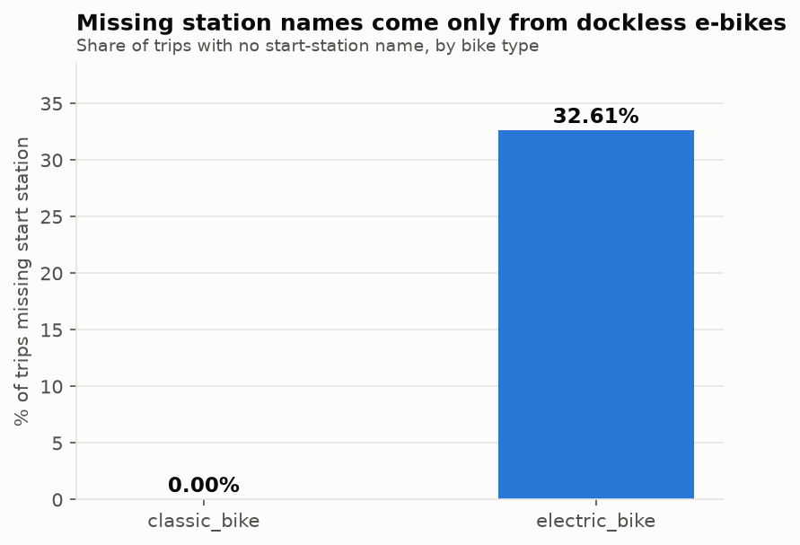
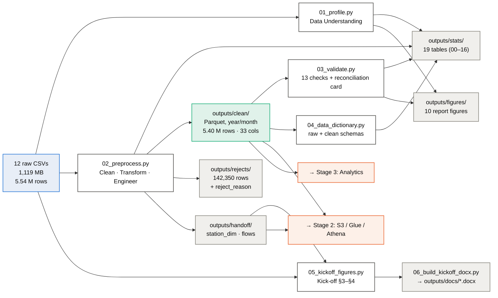

# DES431 — Divvy Bike-Share Big Data Pipeline

**Data Understanding & Preprocessing workstream** · Big Data Analytics and Machine
Learning · Sirindhorn International Institute of Technology

A reproducible pipeline that turns 12 months of raw Chicago bike-share trip records
into a validated, feature-engineered dataset ready for the group's analytics stages.

> **Scope.** This repository is **Workstream 1 of 6**: *Data Understanding* and
> *Data Preprocessing*. The AWS pipeline (S3, Glue, Spark, Athena) is Workstream 2
> and belongs to another team member; analytics is Workstream 3. Nothing here has
> ever touched an AWS service — no SDK, no credentials, no cloud calls. Optional
> starter code offered to the Workstream 2 owner is parked in
> [`for-stage-2/`](for-stage-2/README.md) and is **not** claimed as a deliverable
> of this workstream.

| | |
|---|---|
| **Input** | 5,539,521 trips · 13 columns · 1,119 MB CSV |
| **Output** | 5,397,171 trips · 33 columns · 362 MB Snappy Parquet, Hive-partitioned |
| **Rows removed** | 142,350 (2.57%) — each attributable to one named rule |
| **Validation** | 13/13 automated checks pass |
| **Runtime** | ≈11 min on a laptop, streaming one month at a time |

📄 **[Full methodology and analysis →](DATA_UNDERSTANDING_AND_PREPROCESSING.md)**

---

## The headline finding

20.4% of trips have no start-station name. The reflex is to drop or impute them.
Both are wrong — splitting the missingness by bike type explains **100%** of it:

| Bike type | Trips | Missing start station | Rate |
|---|---:|---:|---:|
| `classic_bike` | 2,077,053 | 0 | **0.00%** |
| `electric_bike` | 3,462,468 | 1,129,029 | **32.61%** |



Divvy e-bikes are **dockless** — a rider can lock one to any public rack, so no
station gets recorded. Classic bikes must be returned to a dock, so they *never*
have a missing station. The nulls encode a real operational mode, which makes this
**MNAR** (Missing Not At Random) rather than damage.

Treating it correctly instead of calling `dropna()` is worth **1,627,147 trips**:

| Approach | Rows kept | Lost | Population studied |
|---|---:|---:|---|
| `dropna()` on all columns | 3,770,024 | 31.9% | Docked trips only — biased |
| **Rule-based (this pipeline)** | **5,397,171** | **2.57%** | Full system |

Two further data-quality findings — a corrupt `station_id` column that fragments
82.8% of stations if you join on it, and a 24-hour auto-close artefact masquerading
as day-long rides — are documented in
[the write-up](DATA_UNDERSTANDING_AND_PREPROCESSING.md).

---

## Quickstart

```bash
pip install -r requirements.txt

# 1. download the raw CSVs into archive/CSV_Files/  (see archive/README.md)

python scripts/01_profile.py          # profiling → stats 00–10, figures F1–F7
python scripts/02_preprocess.py       # clean+engineer → outputs/clean, rejects, handoff, stats 11–12
python scripts/03_validate.py         # 13 checks + reconciliation card → stats 13–14, F8–F10
python scripts/04_data_dictionary.py  # schemas → stats 15–16

# Kick-off document, sections 3-4
python scripts/05_kickoff_figures.py  # 21 figures K01-K21 + 7 tables
python scripts/06_build_kickoff_docx.py   # → outputs/docs/*.docx
```

Run them in order: each script reads what the earlier ones wrote. `05` also reads
`outputs/handoff/station_dim.csv` (from `02`) and `03_missing_by_biketype.csv`
(from `01`), both tracked in git. It needs the raw CSVs only on its first run, or
with `--refresh`; after that it re-renders from a cached pass. If the CSVs are not
in `archive/CSV_Files/`, point the `DIVVY_RAW_DIR` environment variable at them.

`01`, `02` and `05` stream the raw data **one month at a time** and keep only
running aggregates, so they never hold all 5.5 M rows in memory. `03_validate.py`
is the exception: it loads 19 of the 33 cleaned columns for all 5.4 M rows at
once, so it is the step with the highest peak memory.

## Repository layout

```
├── DATA_UNDERSTANDING_AND_PREPROCESSING.md   full methodology + analysis
├── requirements.txt
├── archive/CSV_Files/          raw CSVs — NOT in git, see archive/README.md
├── scripts/
│   ├── common.py               shared config, thresholds, geohash, haversine
│   ├── 01_profile.py           profiling only, mutates nothing
│   ├── 02_preprocess.py        cleaning, transformation, feature engineering
│   ├── 03_validate.py          assertions + reconciliation card
│   ├── 04_data_dictionary.py   schema docs
│   ├── 05_kickoff_figures.py   kick-off §3–§4 figures + tables (cached)
│   └── 06_build_kickoff_docx.py  assembles those into the Word deliverable
├── for-stage-2/                NOT a Workstream 1 deliverable - see its README
│   ├── spark_preprocess.py     PySpark port for AWS Glue - never executed
│   └── athena_create_table.sql generated DDL - never run against Athena
└── outputs/
    ├── stats/                  19 tables from scripts 01–04 (tracked)
    │   └── kickoff/            7 kick-off tables (tracked; cache gitignored)
    ├── figures/                10 report figures (tracked)
    │   └── kickoff/            21 kick-off figures K01–K21 (tracked)
    ├── docs/                   kick-off document §3–§4 (.docx)
    ├── handoff/                station_dim (WS1), station_hourly_flow (for WS3)
    ├── clean/                  curated Parquet — gitignored, regenerable
    └── rejects/                dropped rows + reason — gitignored, regenerable
```

## Pipeline



## Cleaning rules

Six rules. Each dropped row is tagged with **exactly one** reason and written to
`outputs/rejects/`, so any figure in the report traces back to individual records.

| Rule | Condition | Rationale | Removed |
|---|---|---|---:|
| R1 | `end_lat`/`end_lng` NULL | distance not computable | 5,442 |
| R2 | `ended_at < started_at` | physically impossible | 43 |
| R3 | duration < 60 s | failed checkout / immediate re-dock | 136,390 |
| R4 | duration > 24 h | system auto-close, not a ride | 208 |
| R5 | coords outside Chicago bbox | GPS error | 24 |
| R6 | avg speed > 60 km/h | impossible on a bicycle | 243 |

A missing **station name** is deliberately *not* a rule — see the headline finding.

## Feature engineering

20 engineered columns on top of the 13 source columns. Two are load-bearing:

- **`station_key`** — a surrogate key derived from the normalised station *name*.
  Divvy re-numbered stations mid-period (`13084` → `CHI00307`) *and* recycled old
  IDs for unrelated stations, so `GROUP BY station_id` fragments 82.8% of stations
  and merges 105 unrelated pairs. This collapses 3,435 unreliable IDs onto 1,859
  stable keys.
- **`geohash7`** — a ~153 m spatial cell computed from coordinates, which are
  present on *every* row. Without it, 30.69% of the cleaned dataset would be
  invisible to spatial analysis. Geohashes are hierarchical, so truncating the
  string zooms out with no re-processing.

## What the next stage receives

The boundary of this workstream is an **interface**, not a pipeline:

1. **The output schema** — 33 columns, Snappy Parquet, partitioned by `year`/`month`.
   Parquet because 5.4 M rows have to be serialised somewhere and columnar is the
   sensible choice at that size. The S3 layout, catalogue strategy and any
   re-partitioning are open questions for Workstream 2.
2. **`outputs/stats/14_reconciliation_card.csv`** — the acceptance test. When a
   pipeline is split across people, the cleaning logic tends to get written twice and
   the two versions quietly disagree. Any reimplementation must reproduce all 17
   metrics exactly; if one differs, the implementations have diverged.

Starter code for Workstream 2 — a PySpark port and a generated Athena DDL — is in
[`for-stage-2/`](for-stage-2/README.md), clearly marked as optional and unexecuted.

## Data source

Divvy trip data is published monthly by Lyft Bikes and Scooters, LLC under a
[public licence](https://divvybikes.com/data-license-agreement). It contains no
personally identifying information. This repository stores no raw data — see
[`archive/README.md`](archive/README.md) to fetch it.

## Tooling

Python 3.14.5 · pandas 3.0.3 · numpy 2.4.6 · pyarrow 25.0.1 · matplotlib 3.11.0 ·
python-docx 1.2.0 · Pillow 12.2.0 (the last two only for the kick-off `.docx`, script `06`)

PySpark is not a dependency of this pipeline. It is used only by the unexecuted
starter code in [`for-stage-2/`](for-stage-2/README.md).

No step samples and no step depends on random state, so the pipeline is
deterministic: re-running it reproduces the reconciliation card exactly.
